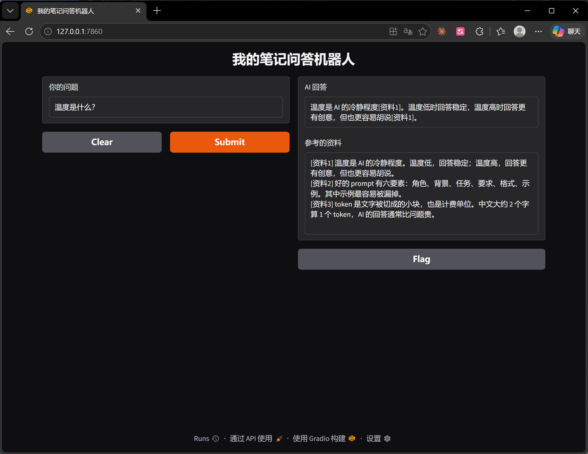
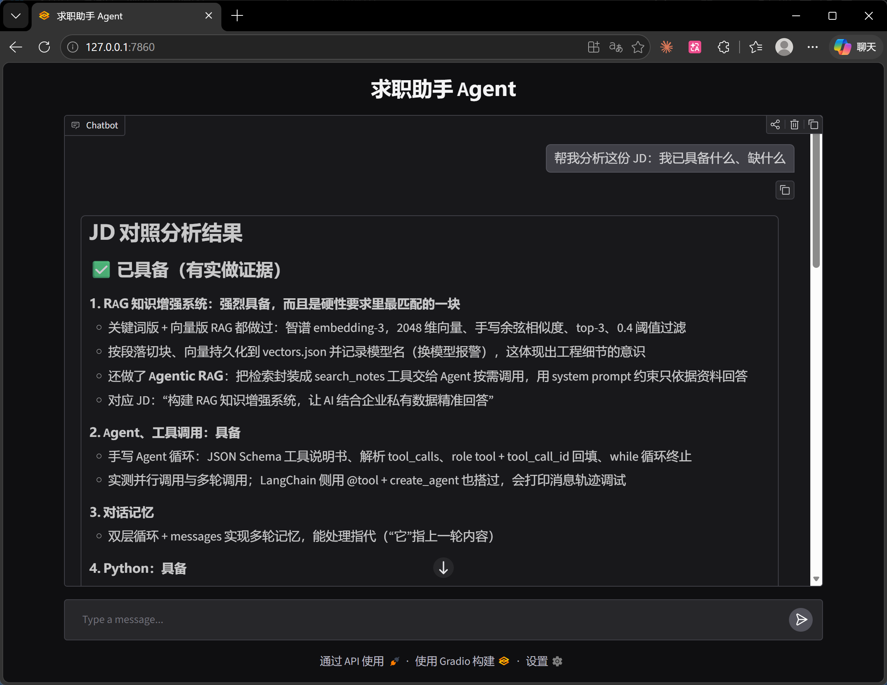

# 大模型应用开发作品集

两个从零手写、能直接运行的大模型应用：

| 项目 | 一句话 | 关键技术 |
| --- | --- | --- |
| [rag-notes-qa](rag-notes-qa/) | 基于个人笔记的问答机器人，回答带出处并自动核验 | RAG、Embedding、余弦相似度、引用溯源、Gradio |
| [job-agent](job-agent/) | 求职助手 Agent：对照岗位 JD 找出技能缺口，出面试题并打分 | Agent、Function Calling、LangChain、LLM-as-judge、Gradio |

模型：DeepSeek（对话）+ 智谱 embedding-3（向量），都通过 OpenAI 兼容接口调用。

---

## 项目一：RAG 笔记问答（rag-notes-qa）



**做什么**：把自己的学习笔记建成知识库，提问时先检索最相关的笔记，再让模型**只依据笔记**回答，每句话标出处 `[资料N]`。

**流程**

1. `build_index.py`（离线建索引）：读 `notes.txt` → 按段落切块、清掉空块 → 调智谱 embedding-3 转成 2048 维向量 → 连同原文和**模型名**存进 `vectors.json`
2. `app.py`（在线问答）：加载索引并**校验模型名**（不一致直接停止，防止新旧向量混用）→ 问题转向量 → 手写余弦相似度打分 → 取前 3 段编号拼进 prompt → DeepSeek 以 temperature=0 回答 → 两层代码核验引用 → Gradio 网页展示回答和参考资料

**亮点**

- **引用溯源 + 自动核验**：system prompt 要求每句标 `[资料N]`、资料里没有就说没有；代码再做两层检查：编号是否真的存在（越界即"引用幻觉"）、每句是否都标了出处
- **索引和查询分离**：资料不变就不重算向量，启动时加载一次、每次提问只算问题的向量
- **手写余弦相似度**：从点积、模长一步步实现，理解原理后再用框架

---

## 项目二：求职助手 Agent（job-agent）



**做什么**：读入一份真实岗位 JD 和自己的技能清单，在聊天网页里：

1. 逐条拆 JD 要求，每条去技能清单里查，列出**已具备（附证据）**和**缺口**
2. 针对某项技能出一道面试题（参考要点先不告诉你）
3. 你作答后，按参考要点打分，给出优点、不足和要点

**结构**：LangChain `create_agent` 编排三件工具

| 工具 | 作用 |
| --- | --- |
| `search_skills` | 技能清单向量检索：只用技能名做向量匹配，命中后返回整段描述（metadata） |
| `make_question` | 固定"出题员" prompt，输出 JSON：题目 + 参考要点 |
| `score_answer` | 固定"打分官" prompt：只评回答里说了的内容，空白或离题 0 分 |

**踩过的坑和解决办法（实测数据）**

- **长段落向量被"搅匀"**：整段技能拿去算向量，查"RAG 系统"排第一的竟是 Gradio（0.47 > 0.438）。改成只比技能名后，RAG 升到 0.647 排第一（small-to-big retrieval）。
- **阈值切不开"相近"和"满足"**："模型微调"对上"调用大模型 API"有 0.586，比真正相关的项还高。改为检索只做粗筛（> 0.5），是否真正满足交给 LLM 判断；最终"微调"被正确判为缺口。
- **工具返回 None**：`return` 缩进错误导致有命中时返回 `None`，Agent 收到大量 `null`。之后每个工具都先单独测试再接入 Agent。
- **记忆**：每轮把 Agent 返回的完整消息轨迹（含工具结果）接回，出题时藏起来的参考要点打分时才能取到。

**已知局限**：对话记忆是全局变量，多人同时访问会串；生产环境应按会话 ID 隔离（如 Redis 或 LangGraph checkpointer）。

---

## 怎么运行

1. 安装依赖（Python 3.10+）：

   ```bash
   pip install -r requirements.txt
   ```

2. 在仓库最外层新建 `.env`，填入自己的钥匙（`.env` 已写进 `.gitignore`，不会上传）：

   ```
   DEEPSEEK_API_KEY=你的 DeepSeek Key
   ZHIPU_API_KEY=你的智谱 Key
   ```

3. 运行项目一：

   ```bash
   cd rag-notes-qa
   python build_index.py
   python app.py
   ```

4. 运行项目二：

   ```bash
   cd job-agent
   python jobagent.py
   ```

浏览器打开 http://127.0.0.1:7860 即可使用。
